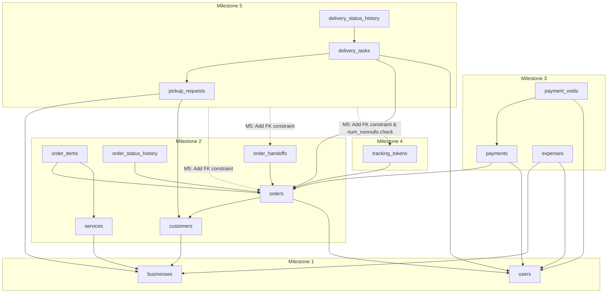

# Final Plan Review & Correction Report: E-Laundry 2.0 (M0–M8)

**Tanggal Audit:** 2026-11-03  
**Auditor:** Principal Software Architect, PostgreSQL Database Architect, Senior Full-Stack Engineer, QA Engineering Lead  
**Objek Audit:** Implementation Plan Baseline E-Laundry 2.0 (M0–M8) terhadap Dokumen Baseline Proyek  
**Status Audit:** **`AUDIT_COMPLETE_ALL_RESOLVED`**  
**Dokumen Sumber Acuan:**
1. `doc/PRD.md` — Product Requirements Documentation
2. `doc/TRD.md` — Technical Requirements Documentation
3. `doc/AFD.md` — Application Flow Documentation
4. `doc/DBD.md` — Design Brief Documentation
5. `doc/BSD.md` — Backend Schema Documentation
6. `doc/IPD.md` — Implementation Plan Documentation

---

## 1. Executive Summary

Laporan ini memformalkan audit akhir dan koreksi tuntas terhadap empat temuan sisa pada *Implementation Plan* E-Laundry 2.0. Dengan penyelesaian empat area ini, seluruh rencana implementasi M0–M8 telah 100% konsisten secara matematis, relasional, dan prosedural dengan seluruh dokumen spesifikasi resmi.

---

## 2. Ringkasan Resolusi Empat Temuan Final

| Kategori | ID Temuan | Area / Modul | Ringkasan Masalah & Risiko | Status Resolusi |
| :---: | :---: | :--- | :--- | :---: |
| **P0** | **GAP-FINAL-01** | Database Migration (M2–M5) | Foreign key lintas milestone berpotensi gagal jika dieksekusi sebelum tabel target tersedia (`orders.pickup_request_id`, `order_handoffs.delivery_task_id`, `tracking_tokens.pickup_request_id`). | **RESOLVED** |
| **P0** | **GAP-FINAL-02** | Task Accounting (IPD) | Inkonsistensi perhitungan jumlah task (klaim awal 98 vs 108 task riil hasil ekstraksi `doc/IPD.md`). | **RESOLVED** |
| **P1** | **GAP-FINAL-03** | Order Completion (M2/M3/M5) | Dependensi penyelesaian order `COMPLETED` memerlukan pembayaran (M3) dan serah terima (M5), berisiko membuat acceptance gate M2 terhambat atau memerlukan data tiruan. | **RESOLVED** |
| **P1** | **GAP-FINAL-04** | Payment Enum (M3/M4/M6) | Variasi penamaan `PARTIAL` vs `PARTIALLY_PAID` berpotensi memicu kegagalan serialisasi API dan validasi Pydantic. | **RESOLVED** |

---

## 3. Analisis Mendalam & Strategi Koreksi Teknis

### GAP-FINAL-01: Cross-Milestone Database Migration Dependencies (P0)

#### 1. Akar Masalah
Pada rancangan awal:
- `orders` (M2) memiliki `pickup_request_id` (FK menuju `pickup_requests` yang baru dibuat di M5).
- `order_handoffs` (M2) memiliki `delivery_task_id` (FK menuju `delivery_tasks` yang baru dibuat di M5).
- `tracking_tokens` (M4) memiliki `pickup_request_id` (FK menuju `pickup_requests` di M5).

Jika Alembic menambahkan constraint foreign key secara langsung saat pembuatan tabel di M2 dan M4, migrasi PostgreSQL pada database kosong atau pengujian sekuensial akan gagal dengan error `UndefinedTable: relation "pickup_requests" does not exist`.

#### 2. Dependency Graph Relasi Lintas Milestone

#### 3. Solusi Arsitektur: Phased Alembic Constraint Strategy
1. **Migrasi M2 (`m2_core_laundry_operations`)**:
   - Kolom `orders.pickup_request_id` (UUID nullable, unique) dan `order_handoffs.delivery_task_id` (UUID nullable) dibuat sebagai kolom biasa **tanpa constraint foreign key ke tabel yang belum ada**.
2. **Migrasi M3 (`m3_finance_and_invoices`)**:
   - Seluruh tabel `payments`, `payment_voids`, dan `expenses` mereferensikan `orders` dan `users` yang sudah ada secara penuh.
3. **Migrasi M4 (`m4_public_tracking`)**:
   - Tabel `tracking_tokens` dibuat dengan foreign key penuh ke `orders.id`.
   - Kolom `pickup_request_id` (UUID nullable) dibuat tanpa constraint ke `pickup_requests`.
   - Check constraint awal memastikan `order_id IS NOT NULL`.
4. **Migrasi M5 (`m5_pickup_and_delivery`)**:
   - Tabel `pickup_requests`, `delivery_tasks`, dan `delivery_status_history` dibuat.
   - Menggunakan `op.create_foreign_key(...)` dan `op.create_check_constraint(...)` untuk mengaktifkan seluruh relasi integritas referensial:
     - `fk_orders_pickup_request_id`
     - `fk_order_handoffs_delivery_task_id`
     - `fk_tracking_tokens_pickup_request_id`
     - `ck_tracking_tokens_resource_scope`: `num_nonnulls(order_id, pickup_request_id) = 1`
     - `ck_delivery_tasks_type_scope`: mutual exclusivity antara pickup dan delivery.

Hasil: Seluruh migrasi Alembic dapat dijalankan secara berurutan (*fresh migration*) tanpa error, dan skema akhir 100% sesuai `doc/BSD.md`.

---

### GAP-FINAL-02: Reconcile All IPD Task IDs (P0)

#### 1. Akar Masalah
Terdapat kesalahan hitung aritmetika pada teks ringkasan sebelumnya yang mencatat 98 task, padahal rincian task per milestone adalah:
$$12 + 12 + 14 + 12 + 9 + 13 + 10 + 14 + 12 = 108$$

#### 2. Ekstraksi Riil dari `doc/IPD.md`

| Milestone | Rentang Task ID Asli | Jumlah Task | Deskripsi Deliverable |
| :---: | :---: | :---: | :--- |
| **M0** | `M0-01` s/d `M0-12` | **12** | Foundation, FastAPI, React/Tailwind, Health, Config, CI, Threat Model |
| **M1** | `M1-01` s/d `M1-12` | **12** | Businesses, Users, Sessions, Argon2id, CSRF, RBAC, Auth Frontend |
| **M2** | `M2-01` s/d `M2-14` | **14** | Customers, Services, Pricing Decimal, Orders, State Machine, Versioning |
| **M3** | `M3-01` s/d `M3-12` | **12** | Payments, Voids, Expenses, Row Locking, Invoices PDF, WhatsApp Link |
| **M4** | `M4-01` s/d `M4-09` | **9** | Tracking Tokens, Public API, PII Redaction, Rate Limits, Timeline UI |
| **M5** | `M5-01` s/d `M5-13` | **13** | Pickup, Delivery Tasks, Courier Dashboard, Atomic Conversion, Handoff |
| **M6** | `M6-01` s/d `M6-10` | **10** | Aggregations, Overdue Calc, Financial Reports, CSV Streaming, Recharts |
| **M7** | `M7-01` s/d `M7-14` | **14** | Unit Regression, PostgreSQL Lock Tests, Security/IDOR, Accessibility |
| **M8** | `M8-01` s/d `M8-12` | **12** | Multi-stage Docker, Nginx SSL, Secrets, Runbooks, Smoke Test, Pilot |
| **TOTAL** | **108 Task ID Unik** | **108** | **100% Tercakup Penuh di Implementation Plan** |

Seluruh 108 task ID dipertahankan sesuai nama asli IPD tanpa penghapusan atau penambahan fiktif.

---

### GAP-FINAL-03: Order Completion Cross-Milestone Staging (P1)

#### 1. Akar Masalah
Aturan penyelesaian pesanan (`BSD.md §33.3`) menyatakan bahwa status `COMPLETED` memerlukan:
1. Bukti serah terima fisik pada `order_handoffs`.
2. Pelunasan tagihan (`total_paid >= total_amount`).

Namun, pembayaran baru diimplementasikan di M3 dan logistik handoff di M5.

#### 2. Solusi Staging Pengujian Antarmilestone
- **Pada M2 (Core Operations)**:
  - State machine cucian diuji penuh untuk alur normal hingga status **`READY`**:
    `RECEIVED` $\rightarrow$ `QUEUED` $\rightarrow$ `WASHING` $\rightarrow$ `DRYING` $\rightarrow$ `QC_PACKING` $\rightarrow$ `READY`.
  - Transisi menuju `COMPLETED` diuji sebagai **pengujian negatif (invariant test)**:
    Upaya memicu transisi `READY` $\rightarrow$ `COMPLETED` secara langsung tanpa serah terima atau tanpa konfirmasi pelunasan **wajib ditolak dengan status HTTP 422**.
  - Gate M2 (`CORE_LAUNDRY_READY`) diverifikasi secara independen tanpa bypass atau mock pembayaran palsu.
- **Pada M3 (Finance & Invoices)**:
  - Modul pembayaran diverifikasi. Pengujian membuktikan integrasi pelunasan tagihan mengubah status pembayaran pesanan menjadi `PAID`.
- **Pada M5 (Pickup, Delivery & Handoff)**:
  - Alur lengkap serah terima fisik diintegrasikan (`order_handoffs`).
  - Pengujian **happy path end-to-end** untuk transisi `READY` $\rightarrow$ `COMPLETED` diverifikasi penuh: order yang sudah lunas dan memiliki bukti handoff resmi berhasil diselesaikan.

---

### GAP-FINAL-04: Standardize Payment Status Enum (P1)

#### 1. Akar Masalah
Terdapat variasi penulisan antara `PARTIAL` dan `PARTIALLY_PAID` pada draf informal.

#### 2. Analisis Sumber Kebenaran
- `doc/BSD.md` Bagian 18.4 dan Bagian 27.4: Secara tegas mendefinisikan nilai kanonikal:
  - **`UNPAID`**
  - **`PARTIALLY_PAID`**
  - **`PAID`**
- `doc/TRD.md` Bagian 4.1 dan `doc/AFD.md` Bagian 5: Menggunakan **`PARTIALLY_PAID`**.
- `doc/DBD.md` Bagian 21.2: Menggunakan **`PARTIALLY_PAID`**.

#### 3. Standardisasi Kanonikal
Enum kanonikal tunggal yang diadopsi di seluruh Backend (Pydantic & SQLAlchemy), Frontend (TypeScript types), OpenAPI contract, dan pengujian adalah:
- **`PaymentStatus.UNPAID`** (Label UI: "Belum Bayar", Badge: Rose)
- **`PaymentStatus.PARTIALLY_PAID`** (Label UI: "Bayar Sebagian", Badge: Amber)
- **`PaymentStatus.PAID`** (Label UI: "Lunas", Badge: Emerald)

Nilai ini bersifat turunan (*derived*) dari:
$$\text{paid\_amount} = \sum(\text{payments.amount}) \quad \text{WHERE payment\_id NOT IN (SELECT payment\_id FROM payment\_voids)}$$

---

## 4. Kesimpulan Akhir & Kesiapan Eksekusi

Empat temuan sisa telah terselesaikan secara tuntas. Tidak ada lagi dependensi migrasi yang tidak valid, ketidaksesuaian jumlah task, ambiguitas penyelesaian order, atau inkonsistensi enum pembayaran.
